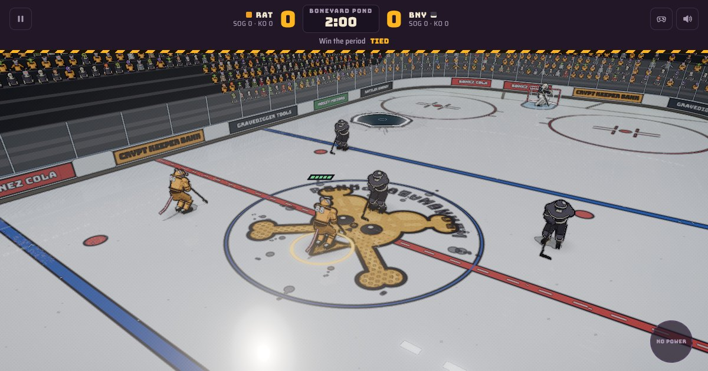

# Rink Rat Mayhem

A 3-on-3 mutant hockey brawler that runs in your browser. Lead the Rink Rats through seven cursed arenas, win one-period challenges to earn XP, and unlock stranger power-ups along the way.

**Play it:** https://ennywnad.github.io/rink-rat-mayhem/



## Features

- **Seven challenges**, each one period with its own arena, hazards and objective: Opening Night, Hot Hands, Body Count, Brick Wall, Gravity Well, Shorthanded and the Mayhem Cup Final. Bonus objectives earn up to three stars each.
- **Progression:** XP unlocks 12 power-ups and more loadout slots. The power-ups are Rocket Skates, Oil Slick, Fireball Puck, Land Mine, Magnet Stick, Shrink Ray, Ice Wall, Heat-Seeker, Kaiju Mode, Split Shot, Thunderstrike and Deep Freeze.
- **Skill stick:** move your stick with the right stick to stickhandle and poke-check. Pull it back and flick it forward to shoot.
- **One-timers and dekes:** press shoot while a pass is on its way to fire it straight off the pass. The deke button does a toe drag toward wherever the right stick points, or a between-the-legs move with the stick centred; defenders in front get fooled for a moment.
- **Versus mode:** full exhibition games from the locker room. P1 vs P2, P1 + P2 vs the CPU, or P1 alone vs the CPU. Pick the opponent team, arena, 2 or 3 skaters a side, 1–3 periods of 2, 3 or 5 minutes, CPU skill and the rules. Ties go to sudden-death overtime.
- **Game stats:** goals, shots, saves, hits, knockouts, possession, passing, takeaways, one-timers, dekes and power-ups for both teams, with goals by period. Shown at every intermission, at the final horn, on challenge results and from the pause menu.
- **Ice resurfacers:** every arena has its own machine that drives out of the ice crew tunnel mid-game, laps the rink and goes home, without waiting for an intermission: The Grave Digger (a hearse hauling a coffin), The Slag Hauler, The Ore Crawler, The Muck Sucker, The Moon Buggy, The Log Skidder and The Angler. Pucks carom off it, the front end flattens anyone it catches, and it honks at skaters in its way. Behind it is a strip of fresh ice that's faster for skaters and pucks for about 24 seconds. It also freezes over open water, scrubs sludge puddles and sets off mines. Turn it off with the **Ice resurfacer** rule.
- **Arena organ:** the only music is a ballpark-style organ: a charge before the opening faceoff, rallies when the Rats press, a fanfare for goals, a sad slide when the other team scores, noodles at stoppages and a loop under the menus and intermissions.
- **Two players on one screen:** co-op (both on the Rats) or versus (P1 Rats vs P2) in Versus mode or practice, and co-op in any challenge. Play with two controllers, a keyboard and a controller, or both on one keyboard.
- **Power-up badges:** an icon over whoever holds the team's power-up, and a timer ring around players with an active effect.
- **Instant replays:** after each goal, the last few seconds replay with a slow-motion moment at the goal and a low camera by the net. Shoot or pass to skip; turn them off under Accessibility.
- **Practice rink:** choose 0–3 opponents, 0–2 teammates, the goalies, the opponents' effort and the clock. Drill opponents carry the puck, lob it up ice, then back off or loop behind their net.
- **Rules and sliders:** turn icing, faceoffs after goals, checking, knockouts, hazards, the ice resurfacer and power-ups on or off. Tune speed, acceleration, shot power, checking, puck control and goalie for each team from 50% to 150%. These work in practice and in the regular challenges.
- **Live stoppages:** players skate to the faceoff dot after goals and icings instead of teleporting, and coasting skaters sometimes lift a skate.
- **Comic-book 3D arena:** cel shading and ink outlines, a crowd of mutant fans in team colors that cheers when its team scores, WebGPU by default with a WebGL2 fallback, plus a classic top-down 2D view.

## Controls

| Action | Keyboard | Controller | Touch |
| --- | --- | --- | --- |
| Skate | WASD / arrow keys | Left stick / D-pad | Drag on the left side |
| Stickhandle, poke-check | I J K L | Right stick | — |
| Skill shot | Hold K (back), then tap I | Pull the right stick back, then flick it forward | — |
| Shoot (hold to wind up) / body-check | Space | A / RT | Shoot button |
| Pass / switch player | Shift | X / LB | Pass button |
| Deke | Q | Y / R3 | — |
| Power-up | E | B / RB | Power button |
| Pause | P / Esc | Start / Menu | Pause button |
| Feel tuning panel | ` (backtick) | Pause menu | Pause menu |
| Mute / unmute | M | Pause menu | Speaker button |

Controllers use the standard browser gamepad mapping (Xbox, PlayStation and Switch Pro all work). The on-screen controls strip shows the buttons for whatever you're using. The right stick follows the camera.

Every key and controller button can be changed under **Controls** in the locker room or the pause menu.

### Two players

Open **Versus** in the locker room for full games, pick **2P co-op** or **2P versus** in practice, or **2P co-op** on a challenge screen. Devices are assigned automatically:

| Connected | Player 1 | Player 2 |
| --- | --- | --- |
| Two controllers | Controller 1 (+ keyboard) | Controller 2 |
| One controller | Keyboard | Controller |
| None | Left side of the keyboard: WASD skate, F shoot, G pass, R power-up, Q deke | Right side: arrows skate, / shoot, . pass, , power-up, ; deke |

P1 is marked amber and P2 cyan.

## Accessibility

The **Accessibility** card in the locker room has a color-blind friendly team palette (Rats in amber and black, every opponent in blue and white, health bars blue to magenta), **Reduce motion** (no screen shake, goal-light flashing, speed lines or pulsing buttons; on by default if your system asks for reduced motion) and three sizes of on-screen buttons for phones (Large by default on touch screens).

## Graphics

Open **Graphics** in the locker room to pick a detail level (Auto, High, Medium, Low or the Classic 2D view) and the 3D engine:

- **WebGPU** (default) gives the best look. It needs a recent Chrome, Edge or Safari.
- **WebGL2 (compatibility)** works on older browsers and GPUs.

If the 3D view fails a startup check, the game steps down on its own: first lower detail, then WebGL2, then the classic view.

## Feel tuning

Press **`** (backtick) or open **Feel tuning** from the pause menu to get live sliders for skating (turn rates, hockey stops), the stick (speed, reach, puck grip), shooting and passing (wind-up, flick zone, shot speed, aim assist) and hits (knockdown threshold, knockback). The game keeps running while the panel is open, changes save in your browser, and **Copy values** puts your changes on the clipboard so they can become the new defaults (`TUNE_DEF` in `js/match.js`).

## Sound

Sound effects are real samples in `assets/sfx/`, generated by `tools/gen_sfx.py` (modal synthesis, filtered noise and formant "voices" run through an arena reverb; needs numpy, scipy and ffmpeg). Each common sound has several takes, played with slight pitch variation, plus a looping crowd that swells near the nets, cheers for Rats goals and groans at the other team's. It also renders the resurfacer's diesel idle and horn (`--zam` rebuilds just those) and the organ cues (drawbar tonewheel voices through a rotary-speaker effect; `python3 tools/gen_sfx.py --organ` rebuilds just those). Mute with **M**, the scoreboard speaker, the pause menu or the **Sound** card in the locker room, which also has volume, crowd and organ sliders.

## Saves

Progress is saved in your browser. To move it to another browser or device, open **Save data** in the locker room, copy your save code, then paste and load it on the other one.

## Run it locally

No build step. Serve the folder with any static file server:

```bash
npm run serve            # or: python3 -m http.server 8123
# open http://localhost:8123
```

Opening `index.html` straight from disk won't work: the browser blocks ES module imports from `file://` pages.

Add `?debug` to the URL to expose test hooks (debug camera, renderer internals) on `window.__r3d`.

### Smoke test

```bash
npm install
npx playwright install chromium
npm run serve &
npm test
```

The test plays a few seconds of a challenge and a practice in both the classic and 3D views, starts a two-player versus game and checks that player 2 can skate, round-trips a save code, and fails on any page error. GitHub Actions runs it on every push, then deploys to GitHub Pages.

## Project layout

```
index.html            page markup and import map
css/style.css         UI styles
js/core.js            helpers, rink geometry, content (powers, challenges, teams), saves
js/audio.js           sample loader, mixer, crowd, sound effects and arena organ
js/match.js           match state, feel tuning, accessibility, rules and practice config
js/physics.js         skating, the stick blade, shots, passes, one-timers, dekes, goalies, pucks
js/resurfacer.js      arena ice resurfacers: route, collisions, fresh ice, hazard clean-up
js/flow.js            instant replay and challenge objectives
js/stats.js           game stats and the stats table
js/ai.js              computer players, power-ups and crates
js/input.js           remappable keyboard / controller / touch input for one or two players
js/update.js          the per-frame simulation step
js/render2d.js        classic top-down view and scoreboard
js/overlay.js         HUD over the 3D view, player badges, graphics settings, 3D bridge
js/ui.js              menus, practice setup, results, pause, tuning panel
js/versus.js          versus setup, periods, intermissions, overtime and the final
js/main.js            main loop and start-up
js/render3d.js        three.js broadcast renderer (WebGPU / WebGL2, TSL node materials)
vendor/three/         three.js r180 (pinned, served locally)
assets/               icon, social preview, screenshot, sfx/ sound pack
tools/gen_sfx.py      regenerates the sound pack
tests/smoke.mjs       Playwright smoke test
tests/serve.mjs       tiny static server (npm run serve)
.github/workflows/    test + Pages deploy
```

## Credits

- Built with [three.js](https://threejs.org) (MIT).
- Fonts: Bungee, Metal Mania and Saira Semi Condensed from Google Fonts (SIL Open Font License).
- Inspired by the over-the-top arcade hockey games of the '90s. All teams, players, arenas and sponsors are made up.

## License

[MIT](LICENSE)
